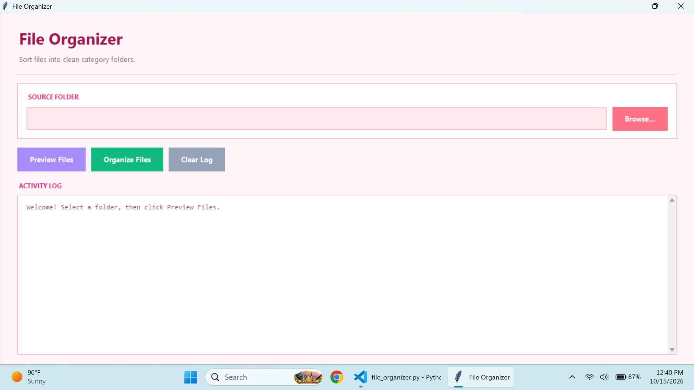
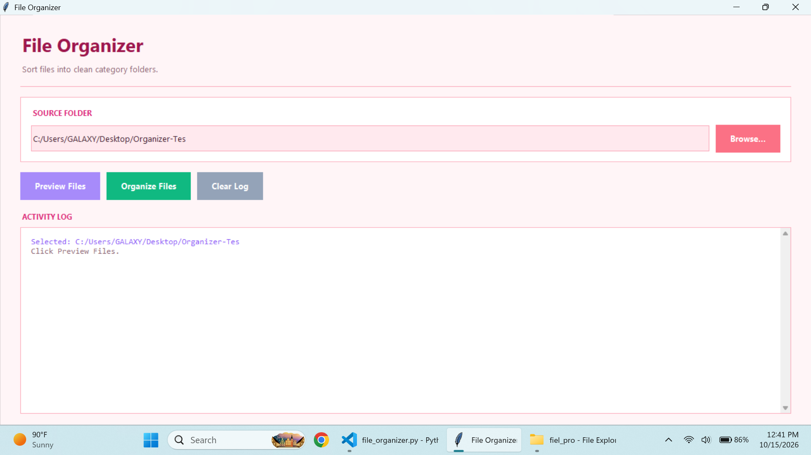
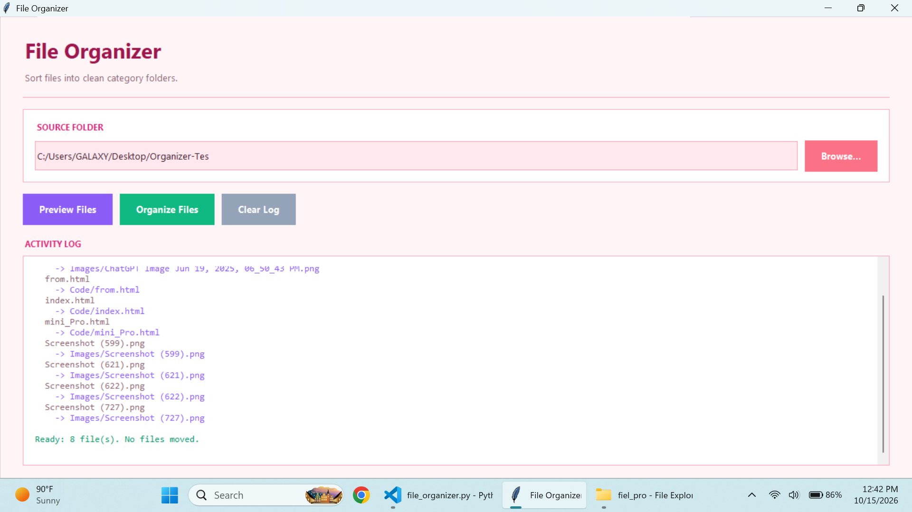
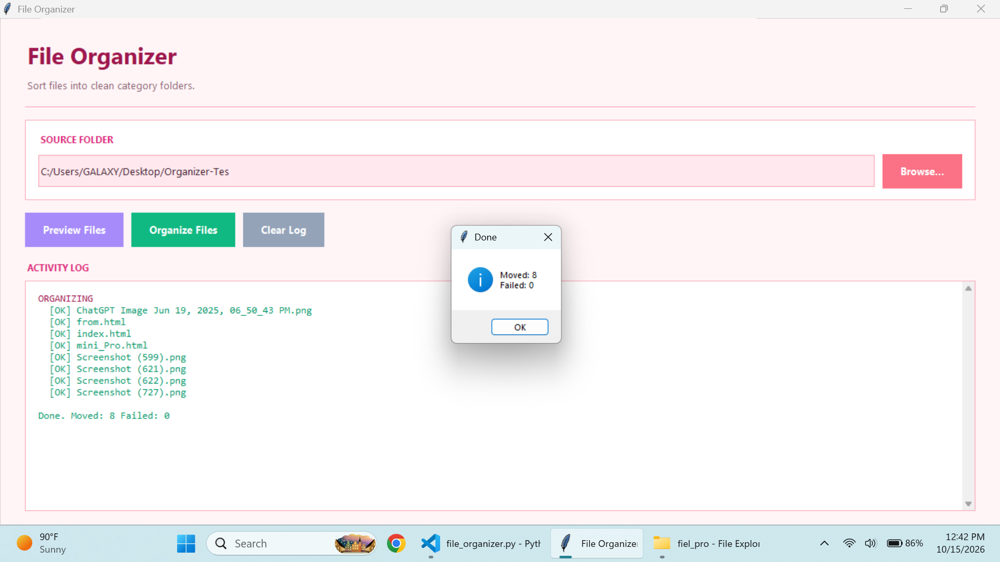
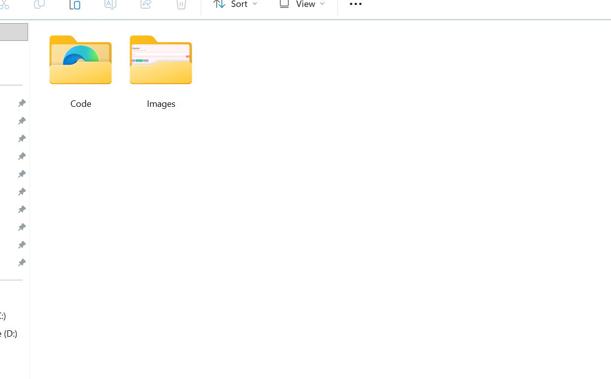

# File Organizer

A Python-based GUI application to organize files automatically into categorized folders. It includes **Browse**, **Preview (Dry-Run)**, **Organize Files**, **Safe Duplicate Handling**, **Live Activity Log**, and **Clear Log** features.

## How to Run

1. Ensure Python 3.8 or higher is installed.
2. Open Terminal or Command Prompt.
3. Navigate to the project folder.
4. Run the following command:

   python file_organizer.py

5. The application window will open automatically.
   - Click **Browse...** to select the source folder.
   - Click **Preview Files** to see a dry-run (nothing is moved).
   - Click **Organize Files** to move files into category folders.
   - Click **Clear Log** to reset the activity panel.

## Features

- Select any source folder via a native folder picker
- Auto-categorization into **Images, Documents, Archives, Media, Code, Others**
- **Preview / Dry-Run** mode before execution (zero disk changes)
- **Safe duplicate handling** — auto-renames with timestamp (no overwriting)
- Live **color-coded** activity log (success, error, accent, muted)
- Skips subfolders and existing category folders (safe to run twice)
- Confirmation dialog before moving files
- Graceful error handling for locked or permission-protected files
- **Zero data loss** — files are only moved, never deleted
- Modern card-based UI with hover effects

## Tech Stack

- Python 3.x
- Tkinter (GUI)
- pathlib (File handling)
- shutil (Safe file move)
- datetime (Timestamped duplicate names)

100% free to use. No paid tools required.

## Files

- file_organizer.py       → Main application
- README.md               → This file
- screenshots/            → App screenshots folder

## Author

Raheela Bhutto
CodeNova Batch 01 — Python Track

## Screenshots

### 1. Main Window

### 2. Folder Selected

### 3. Preview / Dry-Run

### 4. Organize Confirmation

### 5. Organized Folder Structure
